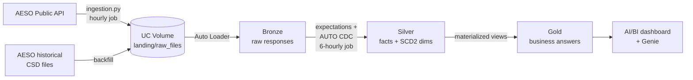

# Alberta Power Market Lakehouse

A governed lakehouse on Databricks that ingests live data from the Alberta Electric System Operator (AESO), models it through a medallion architecture with declarative pipelines and data quality contracts, and tracks the province's generating assets and market participants as SCD Type 2 history.

**Stack:** Databricks (Free Edition, serverless) · Unity Catalog · Auto Loader · Lakeflow Declarative Pipelines · AUTO CDC · Delta Lake · Python · SQL


---

## Business questions

The Gold layer exists to answer these four questions. Everything upstream serves them.

1. When do pool price spikes happen, and what are demand and wind output doing at those moments?
2. What share of each hour's generation is renewable, and how is it trending month over month?
3. What is each generator's capacity factor, and which assets underperform their maximum capability?
4. How does a sharp drop in wind output in one hour affect price in the following hours?

---

## Architecture



| Layer | Contents | Table type |
|---|---|---|
| **Landing** | Raw JSON from the API, one file per feed per run, named with a UTC run timestamp | UC Volume |
| **Bronze** | One row per landed file, payload exactly as received, plus ingestion metadata (`_ingested_at`, `_source_file`, `_batch_id`) | Streaming tables |
| **Silver** | Typed, validated, deduplicated facts; normalized SCD Type 2 asset model | Streaming tables (AUTO CDC) |
| **Gold** | Aggregations answering the business questions | Materialized views |

### Silver data model

| Table | Grain | Notes |
|---|---|---|
| `pool_price` | one row per settlement hour | Latest AESO revision wins |
| `alberta_internal_load` | one row per hour | Actual and forecast load (MW) |
| `generation_snapshot` | one row per asset per AESO update | Net generation, capability, fuel type |
| `dim_asset` | one row per asset version | SCD Type 2 |
| `dim_participant` | one row per participant version | SCD Type 2 |
| `bridge_asset_participant` | one row per asset–participant pair version | SCD Type 2, keys only |

---

## Data sources

All data is public and published by AESO.

- **AESO Public API** (`apimgw.aeso.ca`): pool price, Alberta Internal Load (actual and forecast), current supply and demand by asset, and the asset registry. A free key is available from the AESO developer portal.
- **AESO historical CSD generation files**: per-unit historical generation, used as a one-time backfill.

---

## Engineering highlights

### Data quality as contracts
Every Silver feed has expectations at three deliberate severities:

- **Fail** when the data is untrustworthy (unparseable timestamps, a settled price dated in the future).
- **Drop** rows that don't belong yet (forecast-only hours with no settled price).
- **Warn** on data that is possible but suspicious, so it stays visible instead of hidden (prices outside Alberta's $0–$999.99/MWh bounds, load outside 5,000–15,000 MW, forecast misses over 10%).


### Daylight saving time
AESO publishes both UTC and Mountain Prevailing Time. On November 1, 2026, clocks fell back and one local hour occurred twice. Silver is keyed on UTC, so both hours are kept as distinct records. Local time is stored as `TIMESTAMP_NTZ` for analysis, never as a key.


### Findings from real data
Two duplicate-key failures in the SCD2 flows exposed facts about the source that shaped the model:

- **One asset, several participants.** Asset NX01 is offered by two pool participants. Participant is a many-to-many relationship, not an asset attribute, so it was modeled as a bridge table.
- **Corporate history inside one snapshot.** 32 participant IDs carried more than one name, mostly from mergers and renames (Nexen → CNOOC, ATCO Power → Heartland Generation, EnCana → Ovintiv). Retired assets keep their historic names, and about 43% of registered assets are retired. The current name is chosen from non-retired assets by a deterministic rule.


Full reasoning for every design choice is in [docs/decisions.md](docs/decisions.md).

---

## Orchestration

Two Lakeflow Jobs, decoupled by the landing Volume:

| Job | Schedule (UTC) | Does |
|---|---|---|
| `ab_power_ingest` | every hour at :05 | Pulls all four AESO feeds and lands raw JSON |
| `ab_power_pipeline_refresh` | every 6 hours at :20 | Runs Bronze → Silver over everything landed since the last run |

Ingestion is cheap and runs hourly so no generation snapshot is missed. The pipeline is the expensive step and runs less often without losing data, because Auto Loader picks up every file landed in between. Schedules use UTC so daylight-saving changes never skip or repeat a run. Both jobs retry automatically and alert by email on failure.


---

## Repository structure

```
├── sql/
│   ├── 00_catalog_setup.sql      # schemas and landing Volume (catalog created via UI with Default Storage)
│   └── 01_grants.sql             # least-privilege access model
├── src/
│   ├── ingestion/
│   │   ├── aeso_api_client.py    # API client with retries and backoff
│   │   └── run_ingestion.py      # lands raw JSON in the Volume
│   └── pipelines/
│       ├── bronze.py             # Auto Loader streaming tables
│       └── silver.py             # expectations, AUTO CDC, SCD2 model
├── docs/
│   ├── decisions.md              # architecture decision records
│   └── images/                   # screenshots used in this README
└── README.md
```

---

## Governance

Unity Catalog catalog `ab_power` with schemas `landing`, `bronze`, `silver` and `gold`. Access follows least privilege:

- **Analysts** can read the Gold layer only.
- **Engineers** can build and maintain all layers and read and write the landing Volume.

Grants are set at schema level, so every future table inherits them. See [sql/01_grants.sql](sql/01_grants.sql).


---

## How to run

1. Create a Databricks workspace (Free Edition works) and a catalog named `ab_power` using Default Storage.
2. Run `sql/00_catalog_setup.sql` and `sql/01_grants.sql` on a SQL warehouse.
3. Register for an AESO API key and store it in a secret scope:
   ```bash
   databricks secrets create-scope ab_power
   databricks secrets put-secret ab_power aeso_api_key --string-value "<your key>"
   ```
4. Create a Lakeflow Declarative Pipeline with source folder `src/pipelines/`, default catalog `ab_power`, serverless compute, and the configuration `spark.sql.session.timeZone = UTC`.
5. Create the two jobs described under [Orchestration](#orchestration):
   - `ab_power_ingest`: Python script task on `src/ingestion/ingestion.py`, serverless, cron `0 5 * * * ?` (UTC), 2 retries.
   - `ab_power_pipeline_refresh`: Pipeline task on the pipeline above, cron `0 20 0/6 * * ?` (UTC), 1 retry.
6. Click **Run now** on the ingestion job, then on the pipeline job, to load the first data without waiting for the schedule.

---

## Roadmap

- [x] Unity Catalog setup and least-privilege grants
- [x] API ingestion into a UC Volume
- [x] Bronze: incremental Auto Loader ingestion
- [x] Silver: expectations, AUTO CDC deduplication, normalized SCD2 asset model
- [x] Hourly scheduled job (ingestion → pipeline)
- [ ] Gold: materialized views for the four business questions
- [ ] Historical CSD backfill
- [ ] Delta deep dive: time travel, `RESTORE`, Change Data Feed
- [ ] Cost and reliability monitoring with system tables
- [ ] CI/CD with Databricks Asset Bundles and GitHub Actions
- [ ] AI/BI dashboard and Genie space

---

## Author

**Sivakumar Manoharan**, Data Engineer, Calgary, AB
[LinkedIn](https://www.linkedin.com/in/sivakumarmano/) · [GitHub](https://github.com/sivakumarmanoharan)
