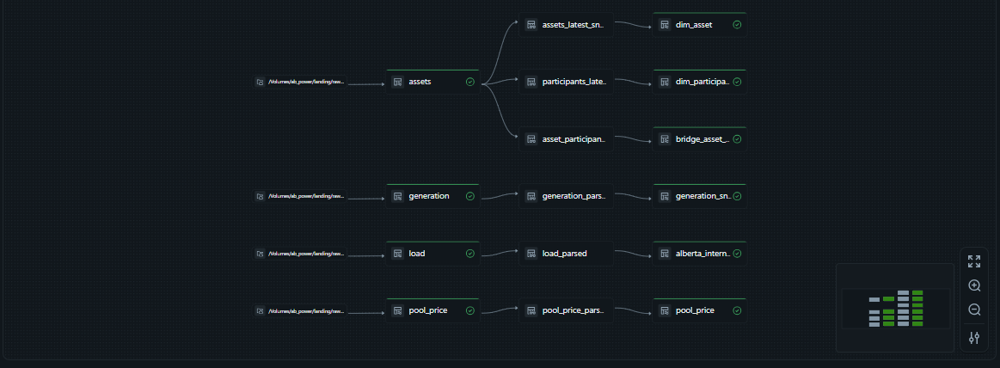
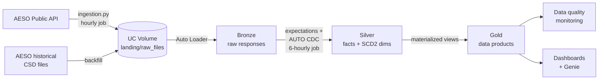
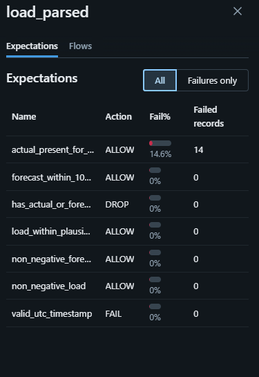
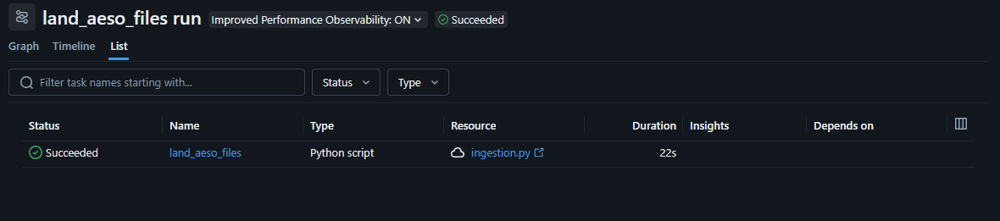

# Alberta Power Market Lakehouse

A governed lakehouse on Databricks that ingests live data from the Alberta Electric System Operator (AESO), models it through a medallion architecture with declarative pipelines and data quality contracts, and tracks the province's generating assets and market participants as SCD Type 2 history. The whole platform is defined as code in a Databricks Asset Bundle and deployed to separate dev and prod environments.

**Stack:** Databricks (Free Edition, serverless) · Unity Catalog · Auto Loader · Lakeflow Declarative Pipelines · AUTO CDC · Lakeflow Jobs · Databricks Asset Bundles · Delta Lake · Python · SQL · GitHub



---

## Business questions

The Gold layer exists to answer these four questions. Everything upstream serves them.

1. When do pool price spikes happen, and what are demand and wind output doing at those moments?
2. What share of each hour's generation is renewable, and how is it trending month over month?
3. What is each generator's capacity factor, and which assets underperform their maximum capability?
4. How does a sharp drop in wind output in one hour affect price in the following hours?

---

## Architecture



| Layer | Contents | Table type |
|---|---|---|
| **Landing** | Raw JSON from the API, one file per feed per run, named with a UTC run timestamp | UC Volume |
| **Bronze** | One row per landed file, payload exactly as received, plus ingestion metadata (`_ingested_at`, `_source_file`, `_batch_id`) | Streaming tables |
| **Silver** | Typed, validated, deduplicated facts; normalized SCD Type 2 asset model | Streaming tables (AUTO CDC) |
| **Gold** | Business-ready data products answering the four questions, plus data quality monitoring | Materialized views |

### Silver data model

| Table | Grain | Notes |
|---|---|---|
| `pool_price` | one row per settlement hour | Latest AESO revision wins |
| `alberta_internal_load` | one row per hour | Actual and forecast load (MW) |
| `generation_snapshot` | one row per asset per AESO update | Net generation, capability, fuel type |
| `dim_asset` | one row per asset version | SCD Type 2 |
| `dim_participant` | one row per participant version | SCD Type 2 |
| `bridge_asset_participant` | one row per asset–participant pair version | SCD Type 2, keys only |

### Gold data model

| Table | Grain | Answers | Status |
|---|---|---|---|
| `fact_hourly_market` | one row per UTC hour | Price, load, forecast error, local-time attributes, spike flag. The only place the spike rule is defined. | ✅ Built |
| `agg_price_spike_events` | one row per spike event | Q1: when spikes happen and what demand was doing | ✅ Built |
| `dim_asset_current` | one row per asset | Current asset, participants, latest fuel type and capability in one table for analysts | ✅ Built |
| `fact_hourly_generation_by_fuel` | one row per hour per fuel type | Base for Q2 | Planned |
| `fact_hourly_supply` | one row per hour | Wind, solar, gas, storage, supply cushion; Q1 causes, Q2, Q4 | Planned |
| `agg_generator_performance` | one row per asset per month | Q3: capacity factor, ranked within fuel type | Planned |
| `agg_wind_drop_price_response` | one row per sharp wind drop | Q4 | Planned |

A **spike hour** is one where the price is more than **3× AESO's rolling 30-day average** and above **$100/MWh**. The relative condition adapts to high- and low-price periods; the floor stops small moves in very cheap periods from counting. A **spike event** is a run of consecutive spike hours, derived with a gaps-and-islands pattern, because the source data contains no events.

---

## Data sources

All data is public and published by AESO.

- **AESO Public API** (`apimgw.aeso.ca`): pool price, Alberta Internal Load (actual and forecast), current supply and demand by asset, and the asset registry. A free key is available from the AESO developer portal.
- **AESO historical CSD generation files**: per-unit historical generation, used as a one-time backfill.

---

## Engineering highlights

### Data quality as contracts
Every Silver feed has expectations at three deliberate severities:

- **Fail** when the data is untrustworthy (unparseable timestamps, a settled price dated in the future).
- **Drop** rows that don't belong yet (forecast-only hours with no settled price).
- **Warn** on data that is possible but suspicious, so it stays visible instead of hidden (prices outside Alberta's $0–$999.99/MWh bounds, load outside 5,000–15,000 MW, forecast misses over 10%).



### Data quality monitoring and reconciliation
`src/pipelines/quality.py` adds one monitoring table per Gold data product, refreshed on every pipeline run:

| Table | Checks |
|---|---|
| `dq_fact_hourly_market` | No duplicate hours; row count reconciles with Silver; missing load; gaps in the hourly sequence; local time matches AESO's own local time |
| `dq_price_spike_events` | Spike hours across all events reconcile with spike hours in `fact_hourly_market`; unique event identifiers; each event's span equals its duration |
| `dq_asset_coverage` | `dim_asset_current` is unique and reconciles with Silver; participant arrays are consistent; coverage between the asset registry and the generation feed, measured from both directions |
| `dq_unmatched_generation_assets` | Generation-feed assets missing from the registry (empty is healthy) |

Checks that would make downstream answers wrong **fail** the run and trigger the job's failure alert; checks that may reflect real conditions **warn**. These checks detect and alert rather than block: Gold tables refresh before the checks that read them.

### Time zones
AESO publishes both UTC and Alberta local time. Silver is keyed on UTC, and local time is stored as `TIMESTAMP_NTZ` for analysis, never as a key. Gold derives local time from the UTC key with the `America/Edmonton` time zone, so the two can never disagree.

This mattered sooner than expected. Alberta moved to permanent daylight time in 2026, so clocks did not fall back on November 1, 2026, and the province now stays at UTC−6 year-round. A Gold acceptance test written on the old rules expected a repeated 1 a.m. hour and failed. Checking it against AESO's own local timestamps showed the data was right and the assumption was out of date. Because every table is keyed on UTC, the rule change needed no code change. `dq_fact_hourly_market` now checks this automatically on every run.


### Findings from real data
Duplicate-key failures in the SCD2 flows and profiling of the asset data exposed facts about the source that shaped the model:

- **One asset, several participants.** Asset NX01 is offered by two pool participants. Participant is a many-to-many relationship, not an asset attribute, so it was modeled as a bridge table.
- **Corporate history inside one snapshot.** 32 participant IDs carried more than one name, mostly from mergers and renames (Nexen → CNOOC, ATCO Power → Heartland Generation, EnCana → Ovintiv). Retired assets keep their historic names, and about 43% of registered assets are retired. The current name is chosen from non-retired assets by a deterministic rule.
- **The registry is broader than the generation report.** Only 231 of 852 active SOURCE assets (27.1%) appear in the generation feed. `dq_asset_coverage` measures the match from the generation side as well, to tell a coverage gap apart from mismatched asset codes before asset-level performance analysis is built.


Full reasoning for every design choice is in [docs/decisions.md](docs/decisions.md).

---

## First results

**Sunday, November 1, 2026, 4 p.m. to 9 p.m. Alberta time:** a 5-hour price spike, peaking at **$553.43/MWh** and averaging **$323.50**, several times the normal price level.

| Measure | Value |
|---|---|
| Average load during the event | 11,045 MW |
| Peak load | 11,109 MW |
| Demand forecast error | −31 MW (about 0.3% below forecast) |

Demand was normal and forecast almost exactly, so this spike was **not demand-driven**. Supply-side causes are likely: the event spans sunset, when solar output falls to zero, and evening demand rises. Generation data does not yet cover this date, so wind and supply conditions cannot be confirmed for this event. The planned `fact_hourly_supply` table and the historical backfill address this.

---

## Environments and deployment

Everything Databricks runs is defined in a **Databricks Asset Bundle** (`databricks.yml` and `resources/`): the pipeline, both jobs, their schedules, retries, alerts and configuration. The same code is deployed to two targets; only configuration differs.

| | `dev` | `prod` |
|---|---|---|
| Catalog | `ab_power_dev` | `ab_power` |
| Pipeline | `[dev <user>] ab_power_market_pipeline_new` | `ab_power_market_pipeline_new` |
| Jobs | `[dev <user>]` copies | `ab_power_ingest`, `ab_power_pipeline_refresh` |
| Schedules | Paused (runs only when triggered) | Active |
| Default target | Yes, so a command without `-t` never touches production | No |

No catalog name is hard-coded. Pipeline code uses schema-qualified names (`silver.pool_price`) that resolve against the pipeline's catalog; the landing path comes from pipeline configuration (`landing_root`); the ingestion script takes `--catalog` as a job parameter.

**Change workflow**

1. Work on a feature branch. `main` is protected: pull request required, linear history, no force pushes or deletion.
2. Validate against production without writing: `bundle run ... -t prod --validate-only`.
3. Deploy and run in dev to test with real data in `ab_power_dev`.
4. Open a pull request, review, squash-merge.
5. Deploy `main` to prod.

```bash
databricks bundle validate -t dev
databricks bundle deploy   -t dev
databricks bundle run ab_power_ingest               -t dev
databricks bundle run ab_power_market_pipeline_new  -t dev

databricks bundle run ab_power_market_pipeline_new  -t prod --validate-only
databricks bundle deploy -t prod     # from main, after the PR is merged
```

The existing production pipeline and jobs were **adopted** into the bundle with `bundle deployment bind`, not recreated, so production tables and SCD2 history stay with them.

---

## Operations

### Orchestration
Two Lakeflow Jobs, decoupled by the landing Volume:

| Job | Schedule (UTC) | Does |
|---|---|---|
| `ab_power_ingest` | every hour at :05 | Pulls all four AESO feeds and lands raw JSON |
| `ab_power_pipeline_refresh` | every 6 hours at :20 | Runs Bronze → Silver → Gold → data quality over everything landed since the last run |

Ingestion is cheap and runs hourly so no generation snapshot is missed. The pipeline is the expensive step and runs less often without losing data, because Auto Loader picks up every file landed in between. Schedules use UTC, so changes to local time rules never skip or repeat a run. Both jobs retry automatically and alert by email on failure.



### Incidents
| Date | Incident | Outcome |
|---|---|---|
| 2026-11-11 | [Production pipeline deleted during migration to Asset Bundles](docs/incidents/2026-11-11-prod-pipeline-deleted.md) | Recovered with no data loss; tables moved to the new pipeline, SCD2 history verified |

---

## Repository structure

```
├── databricks.yml                # Asset Bundle: variables, dev and prod targets
├── resources/
│   ├── pipeline.yml              # Lakeflow pipeline definition
│   └── jobs.yml                  # ingestion and pipeline-refresh jobs
├── sql/
│   ├── 00_catalog_setup.sql      # schemas and landing Volume (catalog created via UI with Default Storage)
│   └── 01_grants.sql             # least-privilege access model
├── src/
│   ├── ingestion/
│   │   ├── aeso_api_client.py    # API client with retries and backoff
│   │   └── ingestion.py          # job script: lands raw JSON in the Volume
│   └── pipelines/
│       ├── bronze.py             # Auto Loader streaming tables
│       ├── silver.py             # expectations, AUTO CDC, SCD2 model
│       ├── gold.py               # data products answering the business questions
│       └── quality.py            # data quality monitoring and reconciliation
├── docs/
│   ├── decisions.md              # architecture decision records
│   ├── incidents/                # incident reports
│   └── images/                   # screenshots used in this README
└── README.md
```

---

## Governance

Unity Catalog catalogs `ab_power` (prod) and `ab_power_dev` (dev), each with schemas `landing`, `bronze`, `silver` and `gold`. Access follows least privilege:

- **Analysts** can read the Gold layer only, including the data quality tables.
- **Engineers** can build and maintain all layers and read and write the landing Volume.

Grants are set at schema level, so every future table inherits them. See [sql/01_grants.sql](sql/01_grants.sql).


---

## How to run

1. Create a Databricks workspace (Free Edition works) and two catalogs, `ab_power` and `ab_power_dev`, using Default Storage.
2. Run `sql/00_catalog_setup.sql` for each catalog, and `sql/01_grants.sql`, on a SQL warehouse.
3. Register for an AESO API key and store it in a secret scope:
   ```bash
   databricks secrets create-scope ab_power
   databricks secrets put-secret ab_power aeso_api_key --string-value "<your key>"
   ```
4. Install the Databricks CLI and log in: `databricks auth login --host <workspace-url> --profile <name>`.
5. Set the workspace host in `databricks.yml`, then deploy and run dev:
   ```bash
   databricks bundle deploy -t dev
   databricks bundle run ab_power_ingest -t dev
   databricks bundle run ab_power_market_pipeline_new -t dev
   ```
6. Deploy prod with `databricks bundle deploy -t prod`. Run ingestion before the first pipeline run in any environment: Auto Loader cannot infer a schema from an empty landing folder.

---

## Roadmap

- [x] Unity Catalog setup and least-privilege grants
- [x] API ingestion into a UC Volume
- [x] Bronze: incremental Auto Loader ingestion
- [x] Silver: expectations, AUTO CDC deduplication, normalized SCD2 asset model
- [x] Scheduled jobs: hourly ingestion, 6-hourly pipeline refresh
- [ ] Gold: data products for the four business questions
  - [x] `fact_hourly_market` and `agg_price_spike_events` (Q1)
  - [x] `dim_asset_current`
  - [ ] Supply and generation tables (Q1 causes, Q2)
  - [ ] `agg_generator_performance` (Q3)
  - [ ] `agg_wind_drop_price_response` (Q4)
- [x] Data quality monitoring and reconciliation tables
- [x] Databricks Asset Bundle with dev and prod targets; production resources adopted with `bind`
- [x] Branch protection and pull-request workflow
- [ ] CI/CD with GitHub Actions: tests, `bundle validate`, deploy on merge
- [ ] Performance: liquid clustering and query profiling
- [ ] Delta: time travel, `RESTORE`, Change Data Feed
- [ ] Power BI report on Gold
- [ ] Runbook and alerting on data quality tables
- [ ] Historical backfill: price and load from the API; generation from CSD files

---

## Author

**Sivakumar Manoharan**, Data Engineer, Calgary, AB
[LinkedIn](https://www.linkedin.com/in/sivakumarmano/) · [GitHub](https://github.com/sivakumarmanoharan)
